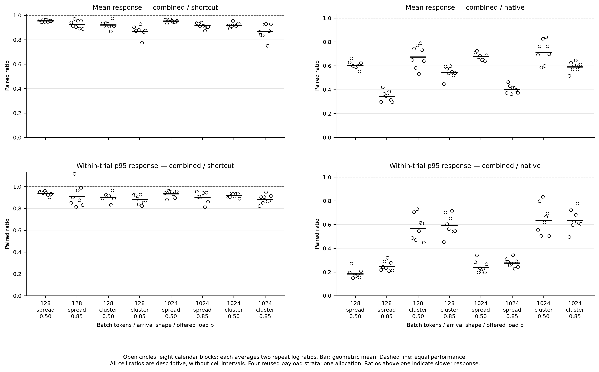
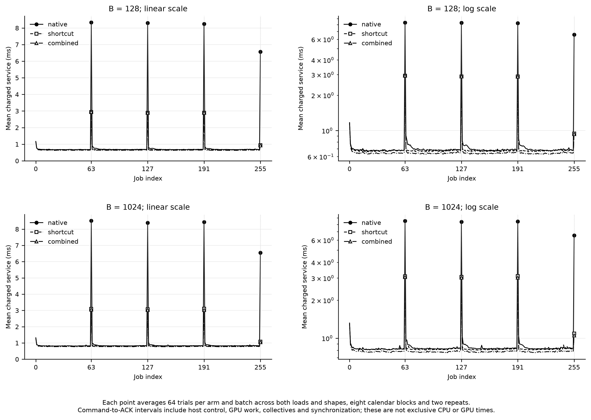

# Does resident dispatch add latency value?

**Yes, within the fixed-residency layer experiment.** Adding the resident dispatcher to the unchanged-map shortcut reduces high-load mean response time by **10.6%** (95% interval: **9.4–11.7% lower**). The combined path is **54.1% lower than native SKIP** (95% interval: **52.3–55.7% lower**) in the contemporaneous comparison. All three prespecified regression guards pass. All 384 final trials and 98,304 jobs completed, without exclusions. This establishes incremental response-latency value on these fresh arrival calendars; the additional completed elapsed-time reduction is only about 0.12%.

The three arms isolate the decision the project now needs: whether adding the existing resident dispatcher improves the already optimized shortcut path. Native uses native physical routing with the existing SKIP policy. Shortcut adds the rank-agreed unchanged-map movement/commit bypass. Combined adds the frozen current-batch resident dispatcher to that shortcut. All three run contemporaneously on the same reserved pair, receive identical payloads and scheduled arrivals within a case, and keep the same fixed resident weights. The historical 48% shortcut result is not reused as a numerical control.

The combined implementation is in `arrival_combo/`; the earlier dispatcher, shortcut and FCFS service wrapper remain unchanged. Online selection runs on each batch's logical routing tensor and charges its histogram, home-selection and mapping kernels to measured service. It does not consume offline assignments or future routes. Native observations, logical aggregation, default proposals and SKIP decisions remain active. The shortcut still charges map equality and unanimous rank agreement, and handles the matching movement and commit together.

Correct composition permits different physical histories while requiring identical logical demand. Native and shortcut retain identical physical assignments. Combined must match its separate resident-dispatch oracle, but its slot counts must reconstruct the same logical counts and planner inputs. Across all arms we require the same candidate and committed maps, source weights and fixed placement, with zero weight traffic. The new proof checks actual native observation and terminal paths at both B128 and B1,024, including two shortcut pairs per optimized arm and 128 current-batch mapper calls in the combined arm of each untimed proof (128 jobs per arm); native and shortcut make no online-mapper calls. Fixed residency remains a precondition: this study does not establish online-dispatch support after an expert migration.

The final experiment contains 384 trials: eight new calendar blocks, two batch sizes, two nominal loads, two arrival shapes, three arms and two reversed technical repetitions. Each trial finishes 256 layer-service jobs, for 98,304 final job completions. Eight new native-only calibrations define capacity and the common arrival horizon. The model is Qwen3-30B-A3B layer 0 in BF16, with hidden size 2,048, intermediate size 768, 128 logical experts, top-eight routing and 32 extra replicas (160 physical slots). Execution retains replicated inputs and output all-reduce. Logical expert IDs and combining weights are captured inputs; physical-copy selection is executed and timed. The held hardware is the same kh014 H100 94 GB/NV6 pair in reservation 4872248. The execution source, protocol, arrival weights and orders were frozen before pilot timing at commit `7620d2c`; final absolute offsets were resolved from native calibration before treatment measurements.

The calendars use new seeds 2026110911–2026110918 and the previously frozen normalized-gamma method: spread shape 4 and clustered shape 0.25, at nominal loads 0.5 and 0.85. Arrival times remain fixed when service falls behind, and every job is retained through drain. The captured payloads and their 32-input repeating sequence are reused. These are fresh synthetic arrival calendars, not unseen source documents, natural traffic or full-model user requests. Each job is a preassembled batch through one model-derived MoE layer; there is no inter-request batching.

Native, shortcut and combined orders are reversed within each case, so pairwise precedence is balanced. The middle arm stays in the middle of a reversed pair; cyclic rotations distribute that position across cases. Exact first/middle/last counts are native 43/42/43, shortcut 43/42/43 and combined 42/44/42. This is near position balance, not exact balance. The pilot uses 24 old-calendar trials and only gates correctness; its performance never selects the treatment or final design.

| Prespecified endpoint | Combined/shortcut ratio | Confidence bound | Criterion | Result |
| --- | ---: | --- | --- | --- |
| High-load mean response | 0.8944 | Two-sided 95%: [0.8831, 0.9058] | Upper < 0.95 | Pass |
| Low-load mean response | 0.9376 | One-sided 98.3333% upper: 0.9405 | Upper ≤ 1.02 | Pass |
| High-load response p95 | 0.8948 | One-sided 98.3333% upper: 0.9108 | Upper ≤ 1.02 | Pass |
| B128 high-load mean response | 0.8988 | One-sided 98.3333% upper: 0.9105 | Upper ≤ 1.02 | Pass |

The secondary combined/native mean-response ratio is **0.4594**, with 95% interval **[0.4428, 0.4766]**. It passes the same upper-bound-below-0.95 target after the incremental gate opens.

The primary estimand is the combined/shortcut high-load mean-response ratio. It averages paired log ratios over repetitions, equally over batch and arrival-shape cells within each block, then over eight calendar blocks. The useful-gain target requires the two-sided 95% interval's upper ratio bound to be below 0.95. Three shortcut-relative guards require one-sided 98.333333% upper bounds no greater than 1.02: low-load mean response, high-load response p95 and high-load mean response at B128. The small-batch guard was chosen before outcomes because the earlier dispatcher had a small-batch regression risk. These margins are engineering targets, not fitted thresholds or numerical tolerances.

Combined/native high-load mean response is a hierarchical secondary 5% test only after the primary and all guards pass. If the gate closes, its point estimate remains descriptive, with no confirmatory interval or pass flag. A large gain over native therefore cannot rescue failure to show incremental dispatcher value. Shortcut/native and all eight cells remain descriptive. Absolute cell means and geometric paired ratios are both retained; dividing pooled absolute means does not necessarily reproduce the primary ratio.

| Batch | Arrival shape | Load | Mean response native / shortcut / combined (ms) | Combined/shortcut | Combined/native |
| --- | --- | ---: | --- | ---: | ---: |
| 128 | spread | 0.50 | 1.2289 / 0.7796 / 0.7442 | 0.9548 | 0.6062 |
| 128 | spread | 0.85 | 2.6285 / 0.9704 / 0.8998 | 0.9275 | 0.3447 |
| 128 | cluster | 0.50 | 3.2797 / 2.3592 / 2.1746 | 0.9222 | 0.6744 |
| 128 | cluster | 0.85 | 7.9995 / 4.9943 / 4.3613 | 0.8709 | 0.5429 |
| 1024 | spread | 0.50 | 1.3144 / 0.9319 / 0.8882 | 0.9531 | 0.6765 |
| 1024 | spread | 0.85 | 2.6746 / 1.1699 / 1.0695 | 0.9145 | 0.4025 |
| 1024 | cluster | 0.50 | 3.7922 / 2.9064 / 2.6745 | 0.9208 | 0.7154 |
| 1024 | cluster | 0.85 | 9.1673 / 6.2602 / 5.4127 | 0.8662 | 0.5913 |

The eight cells are descriptive. Absolute means average trial summaries, while the ratios average paired logs. [Complete timing and queueing table](../results/arrival-combined/final-v1/report/arrival-combo-cells.csv) and [calendar-block ratios](../results/arrival-combined/final-v1/report/arrival-combo-seed-ratios.csv) retain all contrasts, including shortcut/native.

At high load, the added dispatcher reduces mean service by **4.32%**, mean response by **10.56%**, and completed observed elapsed by **0.116%** versus shortcut alone, using paired geometric ratios. The greater response reduction is consistent with less queue accumulation. All 128 matched combined/shortcut pairs improve mean response and service; 126 improve trial response p95. Those counts are descriptive, not 128 independent uncertainty units.

Pooling both loads and arrival shapes, charged ordinary-job service falls from 0.6749 to 0.6444 ms at B128 and from 0.8206 to 0.7849 ms at B1024. In contrast, the nonterminal native control boundaries at jobs 63, 127 and 191 already fall from 8.2973 to 2.9107 ms at B128 and from 8.4457 to 3.0934 ms at B1024 when the shortcut is enabled. Adding resident dispatch changes those boundary means to 2.9100 and 3.0351 ms. This supports an incremental ordinary-service mechanism after the shortcut removes most boundary overhead. These host command-to-acknowledgement intervals are descriptive associations, not exclusive CPU or kernel profiles.

Response is measured from the immutable intended arrival to both-rank completion acknowledgement. Charged service includes CPU commands, GPU work, online selection, synchronization, communication, native planning and shortcut agreement. Completed observed elapsed includes the offered horizon, all drain and end overshoot. Input materialization, warm-up, conditioning and correctness checks are excluded setup and are recorded. Under fixed offered load, a response reduction is not an equal throughput increase. This three-arm design also cannot establish synergy or an interaction; it has no contemporaneous online-only fourth arm.

The architectural accounting also changes in the expected direction. Native and shortcut have identical physical-assignment counters. Combined activates fewer physical copies, creates fewer GEMM M tiles and assigns fewer tokens to the busier rank:

| Batch | Arm | Mean max-rank token assignments | Mean max-rank active copies | Mean max-rank M tiles | Mean rank-summed padded rows |
| --- | --- | ---: | ---: | ---: | ---: |
| 128 | Native = shortcut | 542.77 | 68.37 | 68.43 | 8,622.5 |
| 128 | Combined | 515.26 | 55.80 | 55.88 | 7,118.0 |
| 1,024 | Native = shortcut | 4,320.62 | 73.90 | 81.76 | 20,346.0 |
| 1,024 | Combined | 4,108.24 | 59.76 | 67.96 | 17,085.0 |

These are deterministic work counters averaged over the repeated captured-input sequence. They support the intended dispatch mechanism, but they are neither measured GPU utilization nor substitutes for the completed timings. No weight migration payload or migration messages occur in any arm. The 32,768 measured combined mapper calls are charged to service.

Both GPU composition proofs pass. All 48 unique materialized inputs receive full-batch native-output comparisons before and after each proof; FP32 expert references cover 16 positions in each of two selected inputs. Across archived preflight and postflight checks, the maximum combined-versus-native absolute difference is 0.0078125; the maximum FP32-reference absolute error is 0.008345603942871094. Every declared comparison passes atol=0.02 and rtol=0.03. This is tolerance equivalence, not bitwise equality. The timed outputs are not all archived, so the evidence is preflight/postflight numerical checks plus routing and state invariants, not a numerical comparison of every timed output.

The independent execution audit reconstructs all final clocks and calendars, 1,536 timed native windows, routing artifacts, paired metrics and the eight calibration records. It verifies the exact allocated GPUs, common logical demand and planner trajectories, and preserved committed placement/weights. A separate statistical implementation reproduces every confirmatory endpoint and all 100,000 bootstrap draws; its enumeration of the 81 possible stratum-count outcomes agrees with the reported bounds. Both audits pass, as do **540 CPU tests and 112 subtests**. These are independent implementations within the same team, not outside-laboratory replication.

The uncertainty calculation resamples two complete calendar blocks within each of four fixed payload strata, preserving all nested cells and technical repetitions. The 100,000 PCG64 draws use seed 471432. There are only 81 distinct stratum-count outcomes; more bootstrap draws do not add independent experimental information. The result is conditional on the declared calendar generator, four reused payload states, native calibration and this one allocation. It does not establish performance on a population of documents, other hardware or production serving systems. Independent CPU reanalysis is computational reproducibility of the recorded evidence, not an independent GPU replication.

**Keep the combined option for this fixed-placement arrival workload.** It meets the frozen useful-gain threshold over the shortcut alone while preserving all declared guards and correctness checks. Do not promote it as a general dynamic EPLB dispatcher or a full-model serving optimization. The earlier resident-only small-batch regression and failed broader 5% target remain part of the evidence; passing the present B128 guard on reused payloads does not reverse those findings. A separate GPU replay by another person is the strongest next validation, rather than another parameter search on these results.

The implementation, raw records, exact clocks and calendars, routing artifacts, correctness proofs and independent audits are in [cs471's composition branch](https://github.com/hsylin/cs471/tree/experiments/arrival-combined). The [reproduction guide](https://github.com/hsylin/cs471/blob/experiments/arrival-combined/docs/arrival-combined-reproduction.md) describes GPU execution and standalone CPU checks. Earlier studies and their conclusions remain unchanged. The requested 48-hour reservation stays active until 11 November 2026 at 16:45:31 Zurich time; completed experiments do not cancel it.
