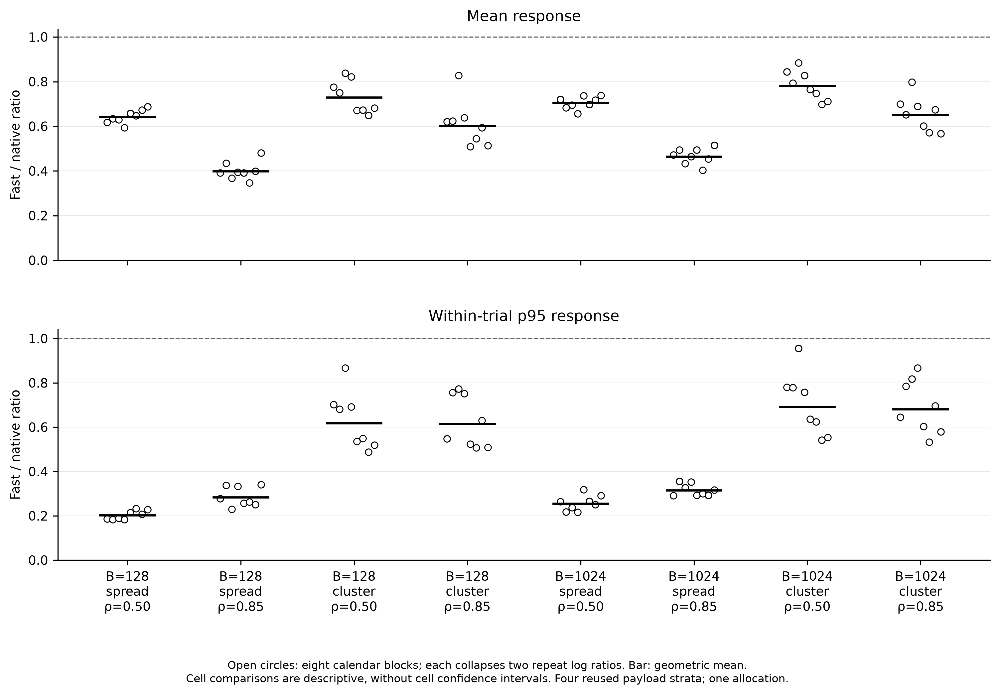
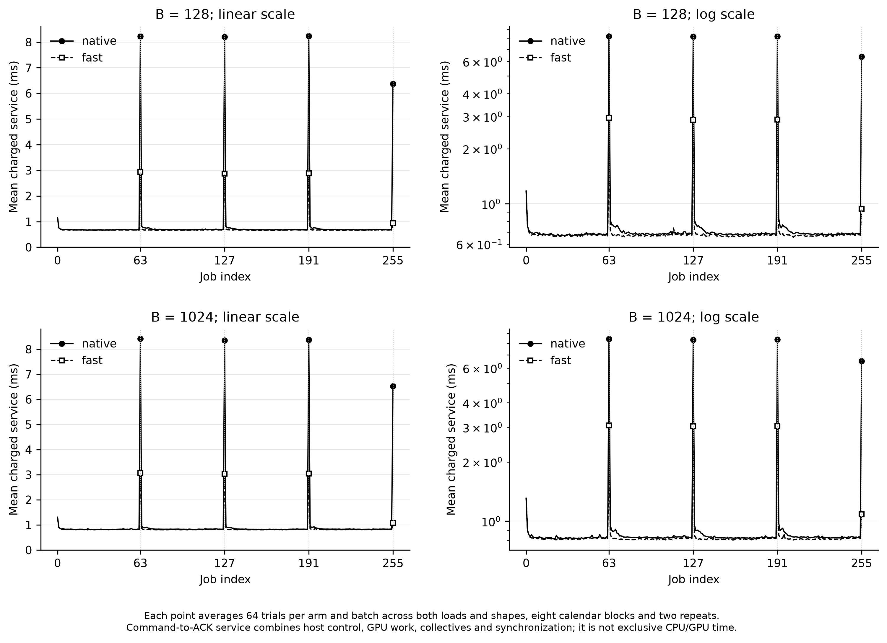

# Response-time improvement from unchanged-map skipping

The unchanged-map fast path produces a measured response-time gain over native SKIP in this fixed two-H100 layer experiment. Across 256 fresh-arrival trials, the prespecified paired high-load mean-response ratio is 0.5196, a **48.0% reduction**, with a 95% ratio interval of [0.5019, 0.5379] (46.2–49.8% lower latency). Both aggregate regression guards pass. High-load mean service falls 11.9%, while completed observed elapsed time falls only 2.1% because both arms face the same offered-load horizon. The 48.0% response reduction must therefore not be described as a 48.0% throughput increase.

Lower mean service time did not reliably reduce response time because response depends on the sequence of service delays and the backlog they create. The earlier 128 trials satisfy the exact FCFS recurrence: each completion equals the later of its planned arrival and the previous completion, plus the residual coordinator gap after readiness, dispatch gap and recorded service residence. The residual gap is admission minus the later of arrival and previous completion; admission minus arrival would include inherited queueing and double-count it. Removing every recorded pre-service gap in an accounting replay still preserves the troublesome native/online reversal. At B=1,024 and high-load constant arrivals, the replay gives 2.675 ms for native and 3.515 ms for online; burst-eight gives 6.042 and 5.120 ms. These counterfactual replays retain observed durations under a different queue, so they diagnose timing sensitivity without estimating an executable speedup.

The main measured removable cost is periodic unchanged-map transition work. In the historical records, jobs 63, 127, 191 and 255 consume roughly 16% of charged service, despite representing only 1.56% of jobs. The last is the terminal unchanged-map path, where the default planner proposal is suppressed; three planner proposals and four movement/commit pairs remain. Ordinary service spikes also remain unexplained. The pinned CUDA EPLB path still invokes weight-movement setup and reconstructs inverse maps when the effective placement is unchanged. Its separate 5% improvement skip is ROCm-specific and does not apply to these H100s. The map reconstruction loops over all 160 physical slots on CPU and copies committed maps back to the device. Zero transferred weight bytes therefore does not imply zero transition cost. This is a finding about the pinned implementation used here, not every vLLM release. [Pinned EPLB transition](https://github.com/vllm-project/vllm/blob/db9527a46873454610df6dbedf79a36d6bf1a7f6/vllm/distributed/eplb/eplb_state.py#L869), [map commit](https://github.com/vllm-project/vllm/blob/db9527a46873454610df6dbedf79a36d6bf1a7f6/vllm/distributed/eplb/eplb_state.py#L1380).

The implemented fast path compares the effective maps and requires unanimous rank agreement before skipping movement and its matching map commit. Agreement and comparison are charged to service. Native physical replica dispatch, expert kernels, planner inputs, planner calls, observation windows, cadence and normal completion stay intact. A changed map takes the original movement and commit operations on both ranks. Unsupported asynchronous, profiling and resizing paths are rejected. The adapter is scoped to this pinned synchronous one-layer configuration; it does not claim general upstream integration.

The separate pilot confirms the mechanism. Mean service at the four boundary jobs falls from 7.816 to 2.444 ms for B128 and from 8.042 to 2.583 ms for B1,024. Diagnostic calls locate approximately 4.3 ms in the original commit and 1.1 ms in original movement setup per rank. The fast comparison and rank agreement together take roughly 0.10–0.12 ms. These are CPU function-wall intervals that include natural blocking, not exclusive GPU kernel shares, and overlapping ranks must not be summed. The primary native baseline has no diagnostic wrapper. The pilot's identical-implementation response ratios span 0.942–1.025, so it cannot certify a one-percent noise floor. Pilot timing did not select a treatment, calendar or acceptance threshold.

The experiment retains one Qwen3-30B-A3B BF16 layer, 128 logical experts, top-eight routing, 160 physical slots and two H100 94 GB GPUs linked by NV6. The originally used pair was busy; the user authorized an equivalent pair. All new phases use exactly the same reserved kh014 devices. There are eight native-only capacity calibrations and 256 final trials: eight new arrival-calendar blocks, two batch sizes, two offered-load fractions, two arrival shapes, two arms and two reversed-order technical repetitions. Each trial drains all 256 jobs. The captured layer payloads are reused; the arrival timing is fresh and synthetic.

The spread and clustered calendars use frozen normalized gamma weights with shapes 4 and 0.25, and nominal loads 0.5 and 0.85 of native calibrated capacity. The normalized fixed-count construction is similar to the pinned serving benchmark's rate normalization, but it is not an unconditioned Poisson process or a natural traffic trace. Planned monotonic arrival times remain immutable when the server is busy. This preserves the intended-arrival latency principle illustrated by wrk2 and avoids omitting delayed work. The experiment does not add dynamic request batching or full-model serving. [Pinned arrival generator](https://raw.githubusercontent.com/vllm-project/vllm/db9527a46873454610df6dbedf79a36d6bf1a7f6/vllm/benchmarks/serve.py), [wrk2 latency accounting](https://github.com/giltene/wrk2).

| Prespecified endpoint | Fast/native ratio | Uncertainty bound | Acceptance rule | Result |
| --- | --- | --- | --- | --- |
| High-load mean response | 0.5196 | 95% CI [0.5019, 0.5379] | Upper < 0.95 | Pass |
| Low-load mean response | 0.7128 | One-sided 97.5% upper 0.7262 | Upper ≤ 1.02 | Pass |
| High-load trial response p95 | 0.4398 | One-sided 97.5% upper 0.4695 | Upper ≤ 1.02 | Pass |

The primary endpoint equally weights the four batch-size/arrival-shape cells at load 0.85 within each calendar block, then averages paired log ratios across blocks. It requires the upper bound of the two-sided 95% interval to be below 0.95. The low-load mean-response and high-load response-p95 guards each require a one-sided 97.5% upper bound no greater than 1.02. All three were frozen before GPU results. Two reversed repetitions are nested within each block. Resampling preserves the four fixed payload strata, with two seed blocks per stratum. The 100,000 bootstrap draws cover only 81 distinct possible block-count combinations; they do not provide 100,000 independent experiments.

All 128 observed paired repetitions have lower mean response, trial response p95 and mean service with the fast path. This is a descriptive count, not 128 independent confirmation experiments. The table gives arithmetic means of trial summaries; the primary estimator instead averages paired log ratios, so dividing pooled table means does not reproduce the 48.0% headline. The separate cell CSV includes queueing, p95/p99, drain, backlog and completed-job rates.

| Batch tokens | Arrivals | Load | Mean response native / fast (ms) | Mean service native / fast (ms) | Completed observed elapsed native / fast (s) |
| --- | --- | --- | --- | --- | --- |
| 128 | spread | 0.50 | 1.2058 / 0.7736 | 0.8071 / 0.7055 | 0.4200 / 0.4152 |
| 128 | spread | 0.85 | 2.4521 / 0.9768 | 0.7996 / 0.6986 | 0.2498 / 0.2446 |
| 128 | cluster | 0.50 | 3.1458 / 2.2910 | 0.8088 / 0.7077 | 0.4224 / 0.4177 |
| 128 | cluster | 0.85 | 7.1586 / 4.3015 | 0.7977 / 0.6941 | 0.2560 / 0.2495 |
| 1024 | spread | 0.50 | 1.3101 / 0.9230 | 0.9525 / 0.8505 | 0.4919 / 0.4871 |
| 1024 | spread | 0.85 | 2.5269 / 1.1718 | 0.9421 / 0.8410 | 0.2922 / 0.2870 |
| 1024 | cluster | 0.50 | 3.5892 / 2.8030 | 0.9494 / 0.8483 | 0.4951 / 0.4903 |
| 1024 | cluster | 0.85 | 8.1081 / 5.3044 | 0.9410 / 0.8352 | 0.2993 / 0.2930 |

At high load, completed observed elapsed averages 0.27431 s for native and 0.26849 s for fast. These observations include the offered horizon, drain, end overshoot and all charged command, acknowledgement, control, communication and GPU-completion work. Common input preparation, warm-up, conditioning and correctness checks are explicitly excluded setup. The measured per-pair geometric elapsed reduction is 2.13%; the mean-service reduction is 11.91%. Reduced service spikes prevent later jobs from inheriting queueing, which produces the larger response benefit.

In final timing, mean boundary service falls from 7.763 to 2.412 ms at B128 and 7.916 to 2.557 ms at B1,024. Ordinary-job service also changes slightly, from 0.693 to 0.674 ms and 0.836 to 0.817 ms. The intervention does not directly change ordinary expert kernels; those smaller differences are observed treatment-arm timing, not proof of a separate kernel optimization.

Correctness includes identical native logical and physical routing, planner trajectories and observation windows, unchanged resident weights and maps, zero weight traffic in both measured arms, and completed rank acknowledgements. Preflight GPU routing covers all 48 unique inputs; timed records retain native observation windows, while full-batch/native and sampled-FP32 numerical checks occur outside timing. Individual timed numerical outputs are not all archived. The separate GPU proof executes two genuine cross-rank weight transitions totaling 28,311,552 sender bytes, verifies normal native commits and numerical outputs, then restores the exact source weight hashes. It also executes two unchanged-map skips. That proof uses B1,024; mixed-rank disagreement is covered by CPU contract tests, not a GPU corruption experiment. An idle asynchronous queue is never substituted for a completed commit.

All 256 final trials and eight calibration trials completed without exclusions. The independent execution verifier reconstructs all 65,536 final jobs, 2,048 calibration jobs, 1,056 observation windows, raw native routing, exact calendars, reversed orders, rank identities and paired summaries. A second implementation reconstructs the statistical endpoints directly from timestamps, reproduces the frozen bootstrap and enumerates all 81 weighted outcomes; the exact distribution and reported interval endpoints agree within floating-point precision. The GPU records report a maximum FP32-reference absolute error of 0.008346 under the fixed tolerances and zero full-batch difference from native reference outputs. The CPU suite passes 490 tests and 75 subtests. The archive retains both startup failures, their logs and the premeasurement repairs; neither failed attempt produced timing rows.

The architectural result is reduced serial map-maintenance residence and its queueing consequences. Routing balance, active replicas and expert work remain the same, so neither lower imbalance nor fewer weight bytes can explain this comparison. Host service occupancy is not GPU utilization. The historical nonboundary spikes are not attributed to GC, OS scheduling, GPU clocks or a particular kernel without direct evidence. Hardware performance counters remain unavailable from the earlier permission probe, and no new utilization claim is inferred from timing alone.

The result is conditional on eight synthetic calendar blocks, four reused payload states, native calibration, one held allocation and this synchronous layer harness. It does not establish full-model response-time improvement, production traffic behavior, benefits when maps actually change, or a stable-workload guarantee beyond the declared aggregate guards. The earlier negative stability-gate and resident-dispatch conclusions remain unchanged. Independent reanalysis checks the recorded evidence; another allocation or laboratory rerun would be an additional empirical test.

Use this unchanged-map shortcut as the optimized implementation for the pinned synchronous layer harness, while retaining native SKIP as the recorded baseline. The evidence supports eliminating redundant movement/commit work before adding a more elaborate dispatcher. Its incremental novelty is an implementation correction and a controlled explanation of queue amplification, not a new load-balancing algorithm. The next external check is an independently executed replay of this same frozen protocol; combining the earlier online dispatcher with the shortcut would be a separate experiment, not an inferred additional gain.

The implementation is in [cs471's arrival-response branch](https://github.com/hsylin/cs471/tree/experiments/arrival-response-fix). The measured source commit is `3f3feb8`; the later report/auditor files do not change the frozen execution hash. The [reproduction instructions](https://github.com/hsylin/cs471/blob/experiments/arrival-response-fix/docs/arrival-response-reproduction.md), [raw records and audits](https://github.com/hsylin/cs471/tree/experiments/arrival-response-fix/results/arrival-response), and [complete cell table](https://github.com/hsylin/cs471/blob/experiments/arrival-response-fix/results/arrival-response/final-v4/report/arrival-fix-cells.csv) make the result reviewable.

The 48-hour reservation remains active as requested: job 4872248 on kh014, ending 11 November 2026 at 16:45:31 Zurich time. No additional GPU experiment is needed to hold the allocation.
