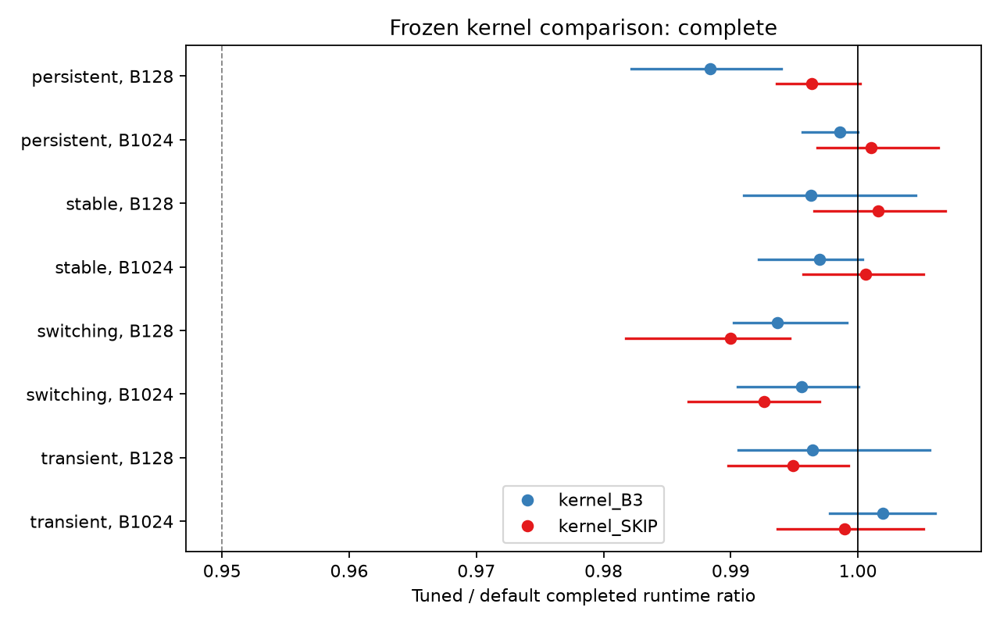

# SkewBench: kernel optimization result

The tested native-kernel change did **not** deliver the declared useful speedup. Across eight fresh held-out document pairs, its completed B3 runtime ratio was **0.995754** (95% block-bootstrap interval **0.994512–0.997028**): a **0.42% lower time estimate**, compared with the predeclared 5% target. The stable-workload guard passed. Identical-configuration controls also produced sub-percent differences, so the aggregate interval below one does not establish that the entire 0.42% came from the kernel change.

For the measured 512-step workload, the strongest tested operating choice remains **fixed placement with the same replica budget**. With default kernels, SKIP took 2.90% less time than B3 on changing traces and 3.51% less on stable traces. These are descriptive policy comparisons, not success on the primary kernel endpoint or a new balancing algorithm. I would keep default kernels and use fixed placement for this bounded workload; the new tile override remains available for reproducibility and further diagnosis. Neither result establishes a full-model serving speedup or the best policy for longer horizons.

## Bottleneck and implemented change

The two expert GEMMs are the largest repeated named GPU cost in the actual profiles: approximately **285–383 microseconds per forward**, compared with 3.1–3.3 microseconds for physical mapping and 17.6–67.6 microseconds of output-allreduce residence. Other device kernels total about 21 microseconds at batch 128 and 55 at batch 1024. These are profiled kernel residence times, not exclusive fractions of unprofiled wall time; collective residence includes arrival waiting. Hardware counters were not collected, so the evidence does not distinguish memory-bandwidth, arithmetic, occupancy, or host-launch saturation.

The earlier payback study found little resident-placement headroom and costly transitions. This made expert-forward execution a stronger optimization target than another migration gate. Large padded expert-token tiles suggested a bounded kernel-tuning experiment. vLLM already provides a configuration override and an [official MoE kernel tuner](https://github.com/vllm-project/vllm/blob/db9527a46873454610df6dbedf79a36d6bf1a7f6/benchmarks/kernels/benchmark_moe.py); this is an engineering evaluation of that mechanism, not a new routing algorithm. The [pinned native implementation](https://github.com/vllm-project/vllm/blob/db9527a46873454610df6dbedf79a36d6bf1a7f6/vllm/model_executor/layers/fused_moe/fused_moe.py) is the source of the executed GEMMs.

I implemented exception-safe configuration overrides, source and actual-configuration checks, a bounded tuner, full-policy replay, separate profiling, and independent analysis and routing auditors in cs471. Eight fixed candidate labels were tested in 192 pilot trials. At batch 128, the frozen rule selected **M64/N64/K64, four warps, three stages**, replacing native M64/N128/K64. At batch 1024 it retained **DEFAULT**, M128/N128/K64 with eight warps. Selection used only two pilot document pairs and was frozen before the final runs.

The padding hypothesis did not survive this search as the selected mechanism. The winning batch-128 setting changes N, retaining M64 and exactly the same observed padding. The two output widths are divisible by both N choices. Actual GPU grids double from 2088/2784 to 4176/5568 thread blocks, while the number of GEMM launches stays two. Matched pilot profiles show only **4.13–6.26 microseconds**, or **1.43–1.89%**, saved inside those GEMMs. The tested M16 configurations at batch 1024 were 8.01–10.39% slower. They also changed warp count, and one changed N, so that slowdown is not a one-factor causal estimate of M alone.

## Fresh held-out evidence

The setup remains two H100 94 GB GPUs connected by NV6, pretrained Qwen3-30B-A3B layer 0, BF16, 128 logical experts, top-8 routing, hidden size 2048, intermediate size 768, and 32 extra replicas. It uses synchronous native EPLB, replicated inputs, output allreduce, and the native torch_nccl weight communicator. The vLLM commit is `db9527a46873454610df6dbedf79a36d6bf1a7f6`; the checkpoint revision is `ad44e777bcd18fa416d9da3bd8f70d33ebb85d39`.

All 20 source documents are disjoint from the previous 20. Ten captured banks contain 40,960 authentic teacher-forced token records. Stable, transient, persistent-change and window-aligned switching schedules select those actual hidden states, routes and combining weights. These are constructed prefill replays, not natural online sessions. The final matrix contains **512 complete runs**, organized as **128 matched four-arm groups**: DEFAULT/TUNED crossed with B3/SKIP, over eight source pairs, four regimes, two batch sizes and two technical repetitions. The preceding full-policy validation had 64 complete runs; profiling used separate processes and 16 recorded rank traces.

Each primary timer covers 512 completed policy steps, including observation, planning, admission, transfers, normal commits and final synchronization. Common per-step timing instrumentation is included. Runtime initialization, JIT compilation, input materialization, 32 observation warmup inputs and correctness checks are outside the timer; excluded setup costs and allocation provenance are retained. This measures steady-state layer replay, not job turnaround or end-to-end input delivery.

| Frozen comparison | Runtime ratio | 95% block interval | Declared conclusion |
|---|---:|---:|---|
| Changing: TUNED+B3 / DEFAULT+B3 | 0.995754 | 0.994512–0.997028 | Fails 0.95 useful-gain target |
| Stable: TUNED+B3 / DEFAULT+B3 | 0.996648 | 0.993133–1.000991 | Passes 1.02 regression margin |
| Changing: TUNED+SKIP / DEFAULT+SKIP | 0.995640 | 0.993732–0.997442 | Fails 0.95 useful-gain target |
| Stable: TUNED+SKIP / DEFAULT+SKIP | 1.001083 | 0.997641–1.004672 | Passes 1.02 regression margin |

*Cell intervals use the declared multiplicity adjustment. The dashed 0.95 line
is the useful-gain target; stable regression uses 1.02. Every batch-1024
TUNED arm is an identical-configuration control.*

Both stable batch cells also pass their adjusted regression intervals. All six changing B3 cells fail the 5% target. Technical repetitions are averaged as paired log ratios before resampling eight source blocks, using 20,000 draws. Cell intervals use the predeclared six-changing/two-stable Bonferroni families; the table reports aggregate intervals. The hand-selected corpus and single final allocation do not estimate production-population or hardware-day variation.

For scale, changing-workload geometric mean times for 512 B3 steps were **257.88 → 256.03 ms** at batch 128 and **329.45 → 329.02 ms** at batch 1024. The latter is an identical-configuration comparison. In one batch-1024 SKIP cell, the adjusted interval excludes one despite identical code and settings. This control limits attribution of small timing differences; it does not undermine the clear failure to approach a 5% gain. The isolated GEMM improvement at batch 128 is supported by changed launch geometry and matched profiles, but cannot be promoted into a large policy improvement.

The descriptive fixed-placement/default-B3 ratios are **0.971004** (interval 0.967392–0.975383) for changing traces and **0.964897** (0.961257–0.968137) for stable traces. SKIP still pays for monitoring and candidate planning in this harness. These comparisons support suppressing unprofitable movement at this cadence and horizon, not a universal claim that migration is harmful.

## Correctness, interpretation and reproducibility

All required records are present and eligible. The independent routing audit reconstructed **3,584 observed windows**, **9,175,040 physical counter entries**, and **11,776 complete maps**. Logical counts match captured routing with the declared two-rank multiplicity; physical replica assignments match an independent CPU reconstruction. Within each policy, both kernel variants and repetitions preserve identical decisions, maps and payloads. Each B3 kernel arm accepts 218 rebalance proposals and sends 118,814,146,560 bytes across its 128 runs; SKIP sends zero. All 512 terminal proposals are suppressed.

Normal synchronous completion, full resident weight/map checks and cross-rank consistency checks pass. No asynchronous drain is treated as a commit. Numerical checks compare full endpoint batches with DEFAULT and 16 evenly spaced tokens with FP32 references, before and after timing. The maximum recorded FP32 absolute error is 0.00392729 and the full-batch DEFAULT difference is at most 0.015625, within the fixed absolute 0.02/relative 0.03 contract. These checks cover two endpoints, not every measured output. All **206 CPU tests** pass.

The verified finding is that the selected N-tile override changes execution and slightly accelerates the matched pilot GEMMs. The deduction is that this small local saving is insufficient to remove the dominant repeated cost or achieve the declared full-policy target. Whether weight traffic, arithmetic efficiency or host launch gaps offers the remaining headroom requires different measurements; the current profiles cannot answer that. Another stability statistic does not address the measured repeated GEMM work, and the earlier payback result still limits what placement alone can recover.

Keep the result bounded: **the new kernel optimization failed its practical target, while fixed placement provides a modest measured benefit against B3 on these traces**. Preserve default kernels as the conservative operating choice. Do not expand the search or select a favorable regime after seeing these outcomes. A future execution-path intervention would need its own diagnosis and fresh frozen validation, rather than inherit a speedup claim from lower padding or imbalance.

The repository retains raw captures, saved replay indices, all timing records, full decision logs, source/configuration hashes, GPU profiles, job logs and reproduction commands. Separate statistical code reconstructs every reported cell and aggregate within 2.22e-16; routing and mechanism checks use the raw artifacts. Clean-checkout CPU reproduction is recorded separately. These are independent implementations by the same team, not an external laboratory GPU replication.

See the [cs471 experiment branch](https://github.com/hsylin/cs471/tree/experiments/kernel-tiling-speedup), [frozen protocol](https://github.com/hsylin/cs471/blob/experiments/kernel-tiling-speedup/docs/optimization-protocol.md), [reproduction instructions](https://github.com/hsylin/cs471/blob/experiments/kernel-tiling-speedup/docs/optimization-reproduction.md), and [raw results](https://github.com/hsylin/cs471/tree/experiments/kernel-tiling-speedup/results/optimization).
