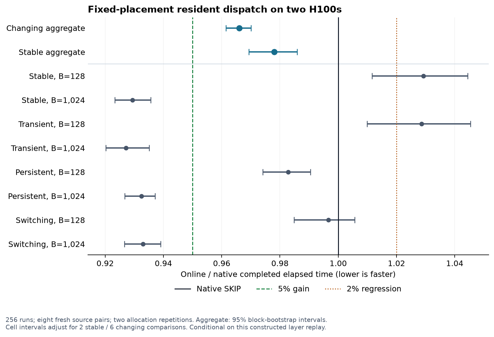

**Resident dispatch on two H100s — completed experiment, 9 November 2026**

**Verdict:** the implemented dispatcher gives a measured, batch-dependent layer-runtime reduction, but fails the frozen criterion for a general replacement of native SKIP. Across the held-out changing workloads, completed elapsed time fell **3.40%** (95% block-bootstrap interval **2.99–3.85%**), below the required 5%. At 1,024 tokens, all four regimes improved by **6.70–7.29%**. Stable 128-token workloads averaged **2.93% slower**. Their adjusted interval spans the 2% regression margin, so that guard is **inconclusive**, rather than proof that the regression exceeds 2%. Overall acceptance is **fail**.

The experiment is implemented and pushed on [experiments/resident-dispatch](https://github.com/hsylin/cs471/tree/experiments/resident-dispatch). The native baseline remains unchanged. Keep native SKIP as the general default; treat the three changing 1,024-token cells as successful prespecified secondary findings. A batch-selective production policy was not tested.

All **256 fresh runs** completed: eight source-document pairs × four constructed regimes × two batch sizes × two arms × two allocation repetitions. No final rows were excluded. Allocations `4869986` and `4870000` used the **same two physical H100s on kh050**, with NV6 connectivity and identical software locks. The paired execution order was reversed between allocations. Both windows showed similar changing-workload ratios: 0.9651 and 0.9670.

| Trace | 128 tokens: online/native ratio (adjusted interval) | 1,024 tokens: online/native ratio (adjusted interval) |
|---|---:|---:|
| Stable | 1.0293 [1.0116, 1.0444] | 0.9294 [0.9233, 0.9357] |
| Transient | 1.0286 [1.0099, 1.0454] | 0.9271 [0.9203, 0.9351] |
| Persistent | 0.9828 [0.9741, 0.9904] | 0.9325 [0.9267, 0.9372] |
| Switching | 0.9966 [0.9849, 1.0056] | 0.9330 [0.9266, 0.9391] |

Ratios below 1 mean lower completed elapsed time. Cell intervals adjust for two stable or six changing comparisons. The changing aggregate is **0.9660 [0.9615, 0.9701]**; its entire interval misses the 0.95 target. The stable aggregate passes its guard, but aggregation does not erase the small-batch slowdown. All three changing 1,024-token cells pass their prespecified 5% criteria.

**What changed.** `resident_dispatch/online.py` and `online_gpu.py` implement one fixed current-batch dispatcher. It counts the logical top-8 routes on the GPU, assigns each shared expert’s tokens to one already-resident copy, and maps/records the resulting physical IDs. Three kernels implement a deterministic greedy token-load assignment under optimal active-copy-count caps. Selection uses the current batch only. It changes neither logical expert choices nor combining weights, and moves no expert weights. The token-balancing step is greedy; it is not the exact dynamic program used for optimistic headroom, and no runtime optimum is claimed.

**Why this direction was worth testing.** The revised headroom pilot passed its frozen A/A screen: maximum identical-code cell deviation was 0.532%. With assignment selection performed offline, one-copy dispatch reduced completed time by 7.45–8.42% across the two development blocks. Token balancing alone barely helped. Separate profiles of one development domain showed roughly 14–16% shorter fused-GEMM durations under one-copy assignments, compared with the same precomputed-native adapter. This supports redundant-copy activation and padding of small token groups as contributors to expert-kernel cost. It does not prove a memory-bandwidth roofline: no hardware memory counters were collected, and NCCL residence can include waiting for a late peer. The Nsight compatibility warning and raw traces are retained.

**What limits the online gain.** The charged development comparison averaged 4.42% lower elapsed time, with a 3.81% slowdown in one small-batch cell. Separate mapper-only CUDA-stream intervals measured about 34 microseconds online versus 21 native, including CPU launch gaps. That roughly 13-microsecond added cost is direct evidence of overhead, not a subtraction of whole-layer runtimes. The greedy assignment kept the same optimal active-copy peak and total padded work on all 384 development inputs; its peak token load averaged only 0.409% above the DP assignment. These count diagnostics support the mechanism, but cannot by themselves predict runtime. The evidence makes reducing selector launches and redundant mapping/recording work the most useful next engineering target. Any fused implementation or batch-size guard needs a new held-out test; neither was added after viewing these results.

**Scope and timing.** The configuration stayed at one BF16 Qwen3-30B-A3B layer 0 (hidden 2,048, intermediate 768, 128 logical experts, top-8), with 160 physical slots and 32 redundant copies, 80 slots per GPU. Placement stayed `[0..127,0..31]`. Native DEFAULT expert kernels, synchronous EPLB, replicated inputs and output allreduce were retained. Each measured trial includes 512 completed forwards and native SKIP steps, charging the online selector, physical recording, expert kernels, output collective, native observation/planning and normal synchronous completion. Common input materialization, JIT, reference checks, initialized timing events and the declared 32-prefix plus 64 full-policy conditioning steps are excluded. Conditioning/setup metadata and its combined duration are logged; materialization, compilation and reference construction are not separately timed. This is a warm resident-layer measurement, not full-model serving or startup time.

The vLLM pin is `db9527a46873454610df6dbedf79a36d6bf1a7f6`; the model revision is `ad44e777bcd18fa416d9da3bd8f70d33ebb85d39`. Validation used source commit `0d54786`, final used `4e92b1c`; their measured execution fingerprint is identical. No execution code, policy parameter, kernel configuration or threshold changed after online validation.

**Inference and attempt history.** The primary comparison averages paired log ratios across repetitions and the six changing regime/batch cells within each source block. The frozen bootstrap uses 20,000 draws, seed 10471, resampling the eight blocks. Acceptance requires a primary upper ratio at most 0.95 and stable aggregate/batch upper bounds at most 1.02. Ranks, steps and technical repeats are not extra independent workload samples. An initial headroom attempt was invalidated wholesale after an overlapping diagnostic probe; the next complete attempt failed A/A calibration. Both are preserved. One declared setup revision initialized event handles, exercised the full SKIP path before timing and reset its state; it then passed. The source of the earlier stalls was not established. A separate amendment, recorded before online timing, authorized the requested fresh evaluation after correctness validation even if development missed 5%. No threshold was weakened and no policy was tuned on the fresh data.

**Correctness and reproducibility.** All 369 CPU tests passed. Separate implementations reproduced the final statistics to within 2.36e-16 and reconstructed 320,864,256 unique physical-route entries from authenticated inputs. All 2,048 timed observation windows, logical demand, native planning trajectories, fixed maps, weight-hash invariance and zero migration records passed. The two final allocations produced byte-identical input/assignment artifacts. All 16 fresh source documents exclude the 40 earlier documents by identity and full-content hashes.

GPU preflight checks cover all 544 route batches per final state. Timed route evidence covers native 16-step observation windows: 128 of the 512 measured steps per run. Full-batch outputs are checked before and after timing at raw indices 32, 160, 288 and 543, with FP32 references at 16 token positions per input. The maximum recorded FP32 absolute error was 0.00431865; maximum native-output difference was 0.00781250. Absolute/relative tolerances stayed 0.02/0.03. The independent CPU audits verify recorded numerical attestations; they do not independently rerun GPU arithmetic or inspect unsaved live weight tensors.

**Practical limit.** Both ranks see the same batch here. Different router inputs per source rank would require an agreed assignment or demand exchange to preserve the measured global active-copy bound, and that coordination cost is unmeasured. The prototype supports the frozen map, top-8 and the two tested batch sizes. Inputs are real teacher-forced causal-prefill activations replayed under constructed schedules, not observed serving traffic. The intervals describe these eight selected document pairs and two allocations on one host, not a production workload or hardware population. No independent laboratory has reproduced the result.

The [reproduction guide](resident-dispatch-reproduction.md) provides source pins, environment locks and CPU/GPU commands. The archive retains complete raw captures, both allocations, counter/mapping records, failed attempts, original profiles, a historical headroom source snapshot and independent audit scripts. Model weights are obtained separately from the pinned checkpoint.
