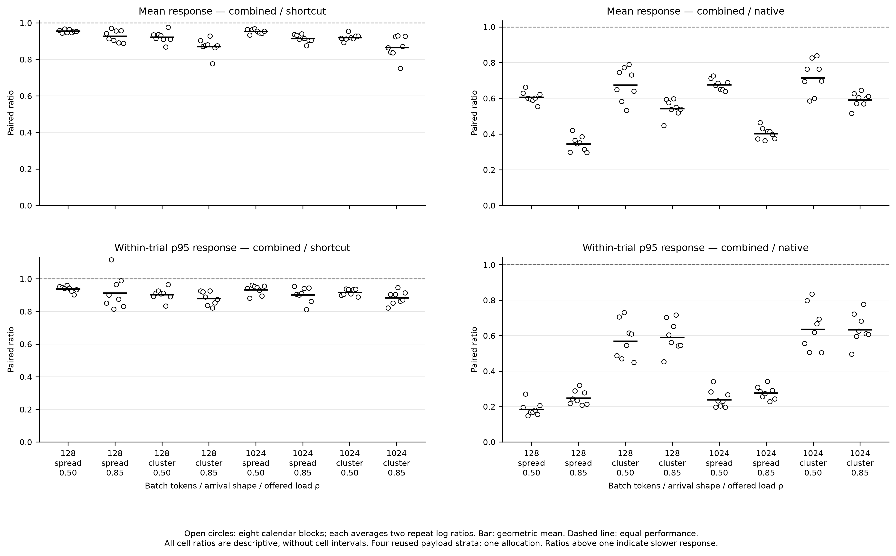
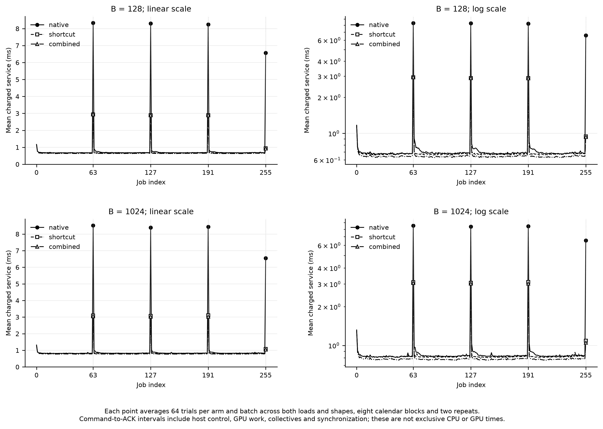

# Three-arm arrival results

Incremental dispatcher acceptance: **pass**. Hierarchical overall acceptance: **pass**.

Native uses the native dispatcher and SKIP policy. Shortcut adds only the unchanged-map shortcut. Combined adds the frozen online resident dispatcher to shortcut. The primary contrast is combined/shortcut; a combined/native gain alone cannot establish incremental dispatcher value.

| Endpoint | Contrast | Ratio | Interval or upper bound | Requirement | Status |
| --- | --- | --- | --- | --- | --- |
| high_load_mean_response | combined_over_shortcut | 0.8944 | 95% CI [0.8831, 0.9058] | Upper < 0.95 | pass |
| low_load_mean_response | combined_over_shortcut | 0.9376 | One-sided 98.333333% upper 0.9405 | Upper ≤ 1.02 | pass |
| high_load_p95_response | combined_over_shortcut | 0.8948 | One-sided 98.333333% upper 0.9108 | Upper ≤ 1.02 | pass |
| b128_high_load_mean_response | combined_over_shortcut | 0.8988 | One-sided 98.333333% upper 0.9105 | Upper ≤ 1.02 | pass |
| high_load_mean_response_baseline | combined_over_native | 0.4594 | 95% CI [0.4428, 0.4766] | Upper < 0.95 | pass |

The three shortcut-relative guards cover low-load mean response, high-load p95 response and B128 high-load mean response. They use Bonferroni-corrected one-sided bounds. A nonpassing guard does not automatically prove a regression. The 5% usefulness and 2% guard margins are carried-forward engineering criteria, not fitted to these outcomes or numerical tolerances.

Inference resamples two calendar blocks within each of four fixed payload strata with the frozen 100,000-draw bootstrap. Only 81 stratum-count combinations exist. Jobs and technical repeats do not increase the eight-block sample size. The claim is conditional on reused payloads, native capacity calibration and one allocation; it does not describe an unseen-document or hardware population.

Exact first/middle/last arm-position counts: {"combined": [42, 44, 42], "native": [43, 42, 43], "shortcut": [43, 42, 43]}. Reversal balances pairwise precedence; position counts are only near-balanced.

N/S/C means native/shortcut/combined. Absolute values below are arithmetic averages of trial summaries; p95 values are averages of within-trial p95s, not pooled percentiles. The CSV additionally includes p50/p99 response, queue/service p95, throughput, backlog and coordinator busy fraction.

| B | Shape | ρ | Mean response N/S/C (ms) | p95 response N/S/C (ms) | Mean queue N/S/C (ms) | Mean service N/S/C (ms) | Observed elapsed N/S/C (s) | Last completion N/S/C (s) | Drain N/S/C (ms) |
| --- | --- | --- | --- | --- | --- | --- | --- | --- | --- |
| 128 | spread | 0.50 | 1.2289 / 0.7796 / 0.7442 | 5.4837 / 1.0631 / 0.9967 | 0.4170 / 0.0701 / 0.0660 | 0.8120 / 0.7095 / 0.6783 | 0.4203 / 0.4154 / 0.4154 | 0.4203 / 0.4145 / 0.4145 | 4.8968 / 0.0000 / 0.0011 |
| 128 | spread | 0.85 | 2.6285 / 0.9704 / 0.8998 | 7.8603 / 2.1465 / 1.9776 | 1.8284 / 0.2737 / 0.2314 | 0.8000 / 0.6967 / 0.6684 | 0.2501 / 0.2445 / 0.2445 | 0.2501 / 0.2444 / 0.2443 | 5.7717 / 0.1944 / 0.1496 |
| 128 | cluster | 0.50 | 3.2797 / 2.3592 / 2.1746 | 9.4564 / 5.8123 / 5.2567 | 2.4735 / 1.6552 / 1.4982 | 0.8062 / 0.7041 / 0.6764 | 0.4218 / 0.4168 / 0.4165 | 0.4217 / 0.4160 / 0.4156 | 6.4071 / 1.4405 / 1.1275 |
| 128 | cluster | 0.85 | 7.9995 / 4.9943 / 4.3613 | 20.1086 / 13.3966 / 11.8086 | 7.1971 / 4.2960 / 3.6962 | 0.8024 / 0.6983 / 0.6651 | 0.2553 / 0.2479 / 0.2474 | 0.2553 / 0.2477 / 0.2472 | 10.9633 / 3.5703 / 3.0881 |
| 1024 | spread | 0.50 | 1.3144 / 0.9319 / 0.8882 | 4.9842 / 1.2612 / 1.1752 | 0.3613 / 0.0748 / 0.0674 | 0.9532 / 0.8571 / 0.8208 | 0.4945 / 0.4901 / 0.4901 | 0.4945 / 0.4890 / 0.4890 | 4.3314 / 0.0000 / 0.0000 |
| 1024 | spread | 0.85 | 2.6746 / 1.1699 / 1.0695 | 8.0387 / 2.4678 / 2.2356 | 1.7310 / 0.3286 / 0.2641 | 0.9436 / 0.8413 / 0.8054 | 0.2939 / 0.2887 / 0.2885 | 0.2939 / 0.2885 / 0.2883 | 5.5915 / 0.3351 / 0.2122 |
| 1024 | cluster | 0.50 | 3.7922 / 2.9064 / 2.6745 | 10.4639 / 7.1135 / 6.5203 | 2.8403 / 2.0533 / 1.8576 | 0.9519 / 0.8531 / 0.8170 | 0.4968 / 0.4919 / 0.4917 | 0.4965 / 0.4908 / 0.4906 | 6.6983 / 1.7087 / 1.5374 |
| 1024 | cluster | 0.85 | 9.1673 / 6.2602 / 5.4127 | 23.1917 / 16.5378 / 14.6148 | 8.2241 / 5.4187 / 4.6066 | 0.9431 / 0.8415 / 0.8061 | 0.3006 / 0.2928 / 0.2922 | 0.3006 / 0.2926 / 0.2919 | 12.2377 / 4.5245 / 3.8714 |

The eight cells and all three contrasts are descriptive. Their ratios average paired logs, so they need not equal ratios of displayed absolute arithmetic means. Each point retains one calendar block after collapsing its two repeats. All three contrasts appear in the CSV; the figure separates incremental value from the native baseline.

Response starts at the immutable scheduled release. Observed elapsed includes the offered horizon, drain and observed end overshoot; last completion is relative to the origin. These are fixed-token layer jobs, not full-model user requests.

Service is measured directly from coordinator command start to completion ACK. Vertical guides mark native control boundaries at jobs 63/127/191 and terminal job 255. Boundary and ordinary-job CSVs are descriptive associations, not isolated component costs or additive CPU/GPU profiles. Each per-step mean/median pools 64 trials per arm and batch.

The architecture CSV summarizes recorded per-rank token assignments, activated physical copies, M tiles and padded rows. It reports means of each rank, the per-job rank maximum and rank sum across all 16,384 observed jobs per arm/batch. These counters motivate mechanisms but are not runtime bounds; correlated job observations receive no inferential test.
