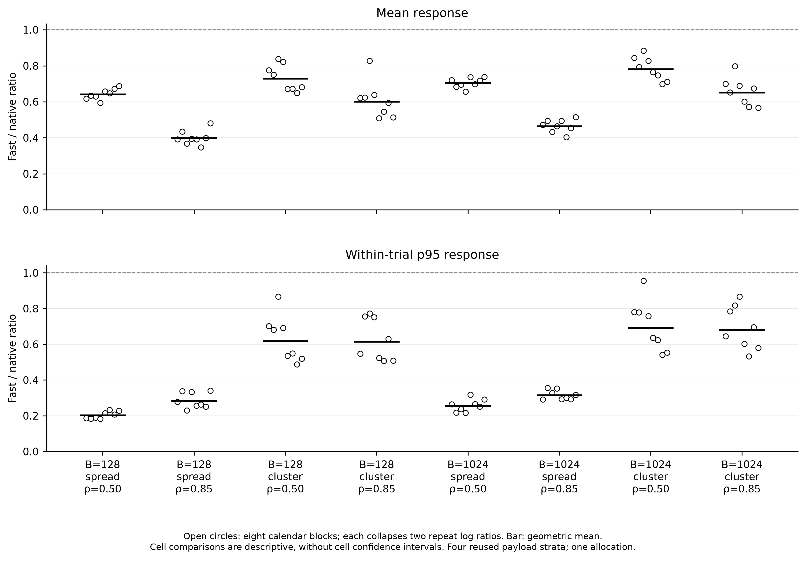
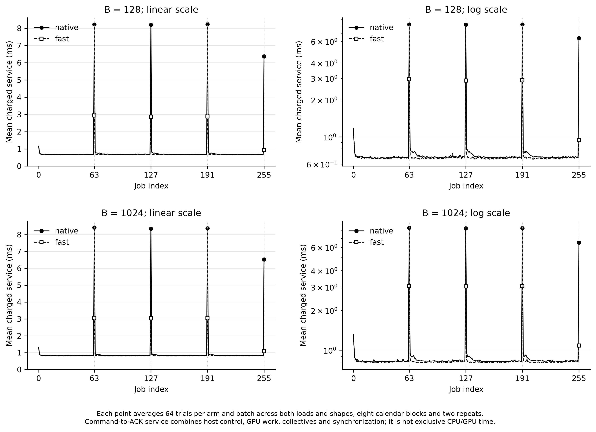

# Arrival-fix results

Prespecified acceptance: **pass**.

These are the three frozen confirmation tests. The eight B/pattern/load cells below are descriptive and receive no additional confidence intervals or acceptance tests.

| Endpoint | Fast/native | Interval or upper bound | Requirement | Status |
| --- | --- | --- | --- | --- |
| high_load_mean_response | 0.5196 | 95% CI [0.5019, 0.5379] | Upper < 0.95 | pass |
| low_load_mean_response | 0.7128 | One-sided 97.5% upper 0.7262 | Upper ≤ 1.02 | pass |
| high_load_p95_response | 0.4398 | One-sided 97.5% upper 0.4695 | Upper ≤ 1.02 | pass |

Primary: high-load mean response. Guards: low-load mean response and high-load p95 response, with Bonferroni correction for the two one-sided guards. A guard that is not established is not automatically proof of a regression.

Inference resamples two calendar blocks within each of four fixed payload strata, using the frozen 100,000-draw bootstrap. It is conditional on reused payloads, native capacity calibration and one allocation. There are only eight independent arrival blocks and 81 distinct stratum-count combinations; jobs and technical repeats do not increase that sample size.

N/F denotes native/fast. Absolute values are arithmetic averages of trial summaries; trial p95 values are not pooled percentiles. The full CSV also includes response p50/p99, queue/service p95, horizon and observation throughput, backlog and coordinator busy fraction.

| B | Pattern | ρ | Mean response N/F (ms) | Trial p95 response N/F (ms) | Mean queue N/F (ms) | Mean service N/F (ms) | Observed elapsed N/F (s) | Last completion N/F (s) | Drain N/F (ms) |
| --- | --- | --- | --- | --- | --- | --- | --- | --- | --- |
| 128 | spread | 0.50 | 1.2058 / 0.7736 | 5.2516 / 1.0598 | 0.3987 / 0.0681 | 0.8071 / 0.7055 | 0.4200 / 0.4152 | 0.4200 / 0.4146 | 4.9522 / 0.0789 |
| 128 | spread | 0.85 | 2.4521 / 0.9768 | 7.6804 / 2.2118 | 1.6525 / 0.2782 | 0.7996 / 0.6986 | 0.2498 / 0.2446 | 0.2498 / 0.2444 | 5.5934 / 0.3791 |
| 128 | cluster | 0.50 | 3.1458 / 2.2910 | 9.5181 / 5.8693 | 2.3370 / 1.5833 | 0.8088 / 0.7077 | 0.4224 / 0.4177 | 0.4213 / 0.4158 | 7.3414 / 2.5853 |
| 128 | cluster | 0.85 | 7.1586 / 4.3015 | 15.9324 / 9.9085 | 6.3610 / 3.6075 | 0.7977 / 0.6941 | 0.2560 / 0.2495 | 0.2560 / 0.2486 | 11.8306 / 5.3206 |
| 1024 | spread | 0.50 | 1.3101 / 0.9230 | 5.0020 / 1.2665 | 0.3576 / 0.0725 | 0.9525 / 0.8505 | 0.4919 / 0.4871 | 0.4919 / 0.4864 | 4.8330 / 0.0834 |
| 1024 | spread | 0.85 | 2.5269 / 1.1718 | 7.8622 / 2.5067 | 1.5848 / 0.3308 | 0.9421 / 0.8410 | 0.2922 / 0.2870 | 0.2922 / 0.2868 | 5.7267 / 0.4731 |
| 1024 | cluster | 0.50 | 3.5892 / 2.8030 | 10.2653 / 7.1053 | 2.6398 / 1.9547 | 0.9494 / 0.8483 | 0.4951 / 0.4903 | 0.4937 / 0.4880 | 8.0759 / 3.2690 |
| 1024 | cluster | 0.85 | 8.1081 / 5.3044 | 17.5313 / 12.0690 | 7.1671 / 4.4692 | 0.9410 / 0.8352 | 0.2993 / 0.2930 | 0.2993 / 0.2919 | 12.7738 / 6.4797 |

Response starts at the immutable scheduled release. Service includes the charged CPU command/ACK, native control, GPU work, collectives and synchronization. Observed elapsed includes the offered horizon, any drain and observed end overshoot; last completion is measured from the origin. These layer jobs are not full-model user requests.

The service plot uses per-step means across 64 trials for each arm and B, including both arrival shapes and loads. Its CSV also gives per-step medians. Vertical guides mark native boundaries at jobs 63/127/191 and the terminal boundary at 255. These host-clock intervals do not isolate individual CPU routines or GPU kernels.
