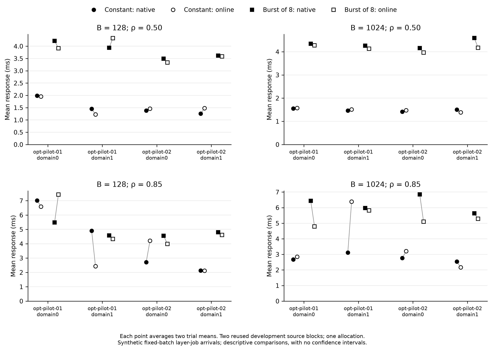

# Supplementary layer-job arrivals

All 32 prespecified cells are shown. N / O denotes native / online. Each number is the arithmetic mean of two trial-level summaries; the p95 column averages the two within-trial p95 values and is not a pooled percentile. Each trial contains 256 jobs. The two reused development source-document pairs and one allocation support a descriptive comparison, without confidence intervals, p-values, or a new performance acceptance decision.

Response is completion minus immutable scheduled arrival. Queue delay includes admission delay; service includes CPU dispatch/ACK and GPU synchronization. Server busy fraction is coordinator service occupancy, not GPU utilization. Both arms completing every job by the same horizon have equal horizon throughput by construction.

| Source block | Domain | B | Arrivals | ρ | Mean response (ms) N / O | Mean queue (ms) N / O | Mean service (ms) N / O | Trial response p95 (ms) N / O | Backlog at H (jobs) N / O | Drain (ms) N / O | Server busy fraction N / O |
| --- | --- | --- | --- | --- | --- | --- | --- | --- | --- | --- | --- |
| opt-pilot-01 | domain0 | 128 | constant | 0.5 | 1.984 / 1.954 | 1.060 / 1.068 | 0.924 / 0.886 | 10.318 / 10.306 | 1.000 / 1.000 | 8.036 / 7.775 | 0.546 / 0.524 |
| opt-pilot-01 | domain0 | 128 | burst8 | 0.5 | 4.219 / 3.914 | 3.290 / 3.029 | 0.929 / 0.885 | 10.634 / 8.867 | 1.000 / 0.500 | 3.610 / 1.634 | 0.555 / 0.531 |
| opt-pilot-01 | domain0 | 128 | constant | 0.85 | 7.017 / 6.594 | 6.085 / 5.653 | 0.932 / 0.942 | 15.772 / 16.100 | 1.500 / 1.000 | 10.917 / 15.935 | 0.914 / 0.906 |
| opt-pilot-01 | domain0 | 128 | burst8 | 0.85 | 5.486 / 7.422 | 4.614 / 6.562 | 0.872 / 0.860 | 12.315 / 16.465 | 1.000 / 1.000 | 8.546 / 4.863 | 0.863 / 0.863 |
| opt-pilot-01 | domain0 | 1024 | constant | 0.5 | 1.551 / 1.571 | 0.528 / 0.567 | 1.024 / 1.004 | 7.001 / 7.570 | 1.000 / 1.000 | 7.524 / 7.289 | 0.506 / 0.497 |
| opt-pilot-01 | domain0 | 1024 | burst8 | 0.5 | 4.342 / 4.275 | 3.339 / 3.277 | 1.003 / 0.998 | 7.373 / 7.775 | 0.000 / 0.500 | 0.000 / 0.776 | 0.503 / 0.500 |
| opt-pilot-01 | domain0 | 1024 | constant | 0.85 | 2.674 / 2.850 | 1.670 / 1.881 | 1.004 / 0.969 | 8.795 / 10.112 | 1.000 / 1.000 | 7.948 / 5.641 | 0.834 / 0.812 |
| opt-pilot-01 | domain0 | 1024 | burst8 | 0.85 | 6.435 / 4.792 | 5.411 / 3.846 | 1.023 / 0.946 | 14.384 / 10.355 | 1.000 / 1.000 | 5.758 / 3.065 | 0.856 / 0.798 |
| opt-pilot-01 | domain1 | 128 | constant | 0.5 | 1.451 / 1.223 | 0.550 / 0.368 | 0.902 / 0.855 | 6.885 / 5.411 | 1.000 / 1.000 | 5.073 / 4.981 | 0.506 / 0.480 |
| opt-pilot-01 | domain1 | 128 | burst8 | 0.5 | 3.936 / 4.330 | 3.021 / 3.371 | 0.915 / 0.959 | 7.833 / 11.534 | 0.500 / 0.500 | 1.325 / 4.001 | 0.518 / 0.539 |
| opt-pilot-01 | domain1 | 128 | constant | 0.85 | 4.901 / 2.434 | 3.969 / 1.593 | 0.931 / 0.840 | 12.380 / 8.603 | 1.000 / 1.000 | 7.954 / 5.752 | 0.872 / 0.794 |
| opt-pilot-01 | domain1 | 128 | burst8 | 0.85 | 4.575 / 4.331 | 3.713 / 3.499 | 0.862 / 0.832 | 10.067 / 9.766 | 1.000 / 1.000 | 3.651 / 3.259 | 0.820 / 0.793 |
| opt-pilot-01 | domain1 | 1024 | constant | 0.5 | 1.461 / 1.508 | 0.428 / 0.512 | 1.034 / 0.997 | 5.992 / 6.944 | 1.000 / 1.000 | 7.162 / 7.116 | 0.509 / 0.491 |
| opt-pilot-01 | domain1 | 1024 | burst8 | 0.5 | 4.265 / 4.131 | 3.257 / 3.160 | 1.008 / 0.971 | 7.233 / 6.978 | 0.500 / 0.000 | 0.870 / 0.000 | 0.503 / 0.485 |
| opt-pilot-01 | domain1 | 1024 | constant | 0.85 | 3.110 / 6.391 | 2.092 / 5.317 | 1.018 / 1.075 | 10.011 / 18.738 | 1.000 / 1.000 | 5.516 / 10.278 | 0.849 / 0.883 |
| opt-pilot-01 | domain1 | 1024 | burst8 | 0.85 | 5.975 / 5.821 | 4.941 / 4.832 | 1.034 / 0.989 | 13.870 / 13.181 | 1.000 / 1.000 | 6.895 / 5.597 | 0.859 / 0.825 |
| opt-pilot-02 | domain0 | 128 | constant | 0.5 | 1.378 / 1.458 | 0.530 / 0.608 | 0.848 / 0.850 | 6.707 / 7.345 | 1.000 / 1.000 | 4.888 / 9.786 | 0.485 / 0.481 |
| opt-pilot-02 | domain0 | 128 | burst8 | 0.5 | 3.492 / 3.337 | 2.660 / 2.538 | 0.832 / 0.799 | 5.896 / 5.630 | 0.000 / 0.000 | 0.000 / 0.000 | 0.481 / 0.462 |
| opt-pilot-02 | domain0 | 128 | constant | 0.85 | 2.708 / 4.210 | 1.865 / 3.356 | 0.843 / 0.855 | 9.482 / 14.150 | 1.000 / 1.000 | 7.946 / 6.188 | 0.804 / 0.821 |
| opt-pilot-02 | domain0 | 128 | burst8 | 0.85 | 4.555 / 3.986 | 3.731 / 3.198 | 0.823 / 0.788 | 10.773 / 9.051 | 1.000 / 1.000 | 3.105 / 3.079 | 0.800 / 0.766 |
| opt-pilot-02 | domain0 | 1024 | constant | 0.5 | 1.417 / 1.479 | 0.426 / 0.516 | 0.991 / 0.963 | 5.897 / 6.752 | 1.000 / 1.000 | 4.698 / 5.386 | 0.496 / 0.482 |
| opt-pilot-02 | domain0 | 1024 | burst8 | 0.5 | 4.160 / 3.964 | 3.165 / 3.025 | 0.995 / 0.938 | 7.090 / 6.749 | 0.500 / 0.000 | 2.650 / 0.000 | 0.500 / 0.474 |
| opt-pilot-02 | domain0 | 1024 | constant | 0.85 | 2.763 / 3.210 | 1.784 / 2.241 | 0.979 / 0.970 | 9.487 / 10.805 | 1.000 / 1.000 | 5.501 / 7.978 | 0.825 / 0.811 |
| opt-pilot-02 | domain0 | 1024 | burst8 | 0.85 | 6.845 / 5.096 | 5.817 / 4.144 | 1.028 / 0.953 | 15.812 / 11.680 | 1.000 / 1.000 | 6.179 / 5.388 | 0.864 / 0.804 |
| opt-pilot-02 | domain1 | 128 | constant | 0.5 | 1.254 / 1.480 | 0.368 / 0.605 | 0.886 / 0.875 | 5.485 / 7.463 | 1.000 / 1.000 | 5.313 / 7.284 | 0.490 / 0.482 |
| opt-pilot-02 | domain1 | 128 | burst8 | 0.5 | 3.614 / 3.584 | 2.752 / 2.728 | 0.862 / 0.856 | 6.128 / 5.988 | 0.000 / 0.500 | 0.000 / 1.144 | 0.483 / 0.478 |
| opt-pilot-02 | domain1 | 128 | constant | 0.85 | 2.134 / 2.123 | 1.275 / 1.288 | 0.859 / 0.834 | 7.695 / 7.873 | 1.000 / 1.000 | 5.521 / 5.462 | 0.801 / 0.778 |
| opt-pilot-02 | domain1 | 128 | burst8 | 0.85 | 4.805 / 4.615 | 3.936 / 3.774 | 0.869 / 0.842 | 10.971 / 11.109 | 1.000 / 1.000 | 3.227 / 3.200 | 0.818 / 0.792 |
| opt-pilot-02 | domain1 | 1024 | constant | 0.5 | 1.508 / 1.390 | 0.468 / 0.395 | 1.040 / 0.996 | 6.651 / 5.613 | 1.000 / 1.000 | 7.127 / 4.730 | 0.509 / 0.489 |
| opt-pilot-02 | domain1 | 1024 | burst8 | 0.5 | 4.594 / 4.174 | 3.524 / 3.187 | 1.070 / 0.986 | 8.632 / 7.139 | 0.500 / 0.000 | 1.122 / 0.000 | 0.529 / 0.489 |
| opt-pilot-02 | domain1 | 1024 | constant | 0.85 | 2.535 / 2.168 | 1.528 / 1.199 | 1.006 / 0.969 | 8.355 / 7.779 | 1.000 / 1.000 | 5.520 / 5.452 | 0.833 / 0.802 |
| opt-pilot-02 | domain1 | 1024 | burst8 | 0.85 | 5.634 / 5.282 | 4.623 / 4.297 | 1.012 / 0.985 | 12.436 / 12.168 | 1.000 / 1.000 | 3.478 / 3.693 | 0.843 / 0.821 |

The figure shows every cell separately, with filled native and open online markers. Circles denote constant arrivals and squares denote bursts of eight; short connectors identify a paired comparison. Panel scales may differ. The raw summary retains both technical repetitions, all quantiles, horizon throughput, window spans, and observation overshoot.
